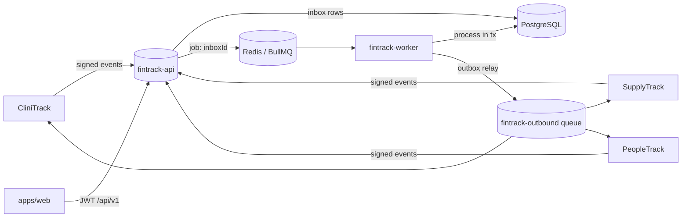
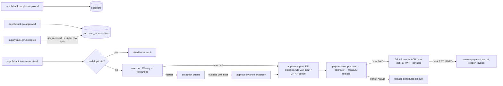

# FinTrack architecture

FinTrack is the financial system of record for multi-facility hospitals in the SynergyOne Track family.
Source applications own operational workflows; FinTrack owns financial posting, settlement and reconciled balances.

| System | Owns | Sends to FinTrack |
|---|---|---|
| CliniTrack | Encounters, clinical billing, claims preparation | Finalised invoices, claim submissions/adjudications, receipts, credit notes |
| SupplyTrack | Suppliers, requisitions, POs, GRNs, returns | Approved supplier master, POs, GRNs/service acceptance, supplier invoices, debit/credit notes, payment requests |
| PeopleTrack | Employees, payroll calculation | Approved, signed, versioned payroll batches and statutory liabilities (no HR detail beyond what posting needs) |
| **FinTrack** | GL, sub-ledgers (AR, AP, payroll liabilities, doctor fund), cash/bank, budgets/vote heads, reconciliation, KPIs, reporting | Outbound events: journal posted, payment executed, settlement, remittance matched |

## Monorepo layout

```
apps/api        NestJS 11 + Prisma 6 (PostgreSQL 16), BullMQ (Redis 7), Swagger at /api/docs
apps/web        Next.js 15 App Router, Tailwind, shadcn-style UI, TanStack Query, RHF + Zod, Recharts
packages/shared Decimal-safe money, status machines, event envelope schemas (Zod), RBAC matrix
docs/           Architecture, ERD, assumptions for finance sign-off, deployment, OpenAPI export
```

## Runtime components



* **api**: stateless HTTP. Validates, authorises, writes to Postgres. Never posts integration events synchronously.
* **worker**: consumes the inbox queue, sweeps retry-due/stuck rows (DB is the source of truth, Redis only accelerates),
  relays the transactional outbox. Scale horizontally; all claims use `FOR UPDATE SKIP LOCKED`.

## Core financial invariants and where they are enforced

| Invariant | Service layer | Database |
|---|---|---|
| Posted journal balances per currency **and** in base currency, per company | `checkBalance()` before insert and before posting | `trg_journals_guard` re-checks on the transition to POSTED |
| Posted journals/lines are immutable; corrections are reversals | `JournalsService.reverse*` | `trg_journals_guard`, `trg_journal_lines_guard` reject UPDATE/DELETE |
| Posting only into OPEN periods, date inside period | `PeriodsService.assertOpen` (FOR SHARE lock) | trigger checks period status and dates |
| Lines use active, postable accounts of the same company | `createDraft` | `trg_journal_lines_guard` |
| Control accounts (AR/AP/payroll/doctor fund/bank) only via sub-ledgers | `allowControlAccounts` flag | – (sub-ledger reconciliation reports, Increment 3+) |
| Maker ≠ checker, approval limits | `approve`/`post` | – |
| Reruns never duplicate postings | `(company_id, idempotency_key)` lookup | unique index |
| Source event processed once | inbox `(source_system, event_id)` unique + `source_entity_versions` PK | unique indexes |
| Audit is tamper-evident | SHA-256 hash chain, `GET /audit/verify` | `trg_audit_log_append_only` (no UPDATE/DELETE/TRUNCATE) |

## Posting lifecycle

Journals: `DRAFT → VALIDATED → APPROVED → POSTED (→ REVERSED)`.
Sub-ledger documents (AP invoices, debtor invoices, payroll batches…) use
`DRAFT → VALIDATED → APPROVED → POSTED → PARTIALLY_SETTLED → SETTLED`, with `DISPUTED` / `ON_HOLD` carried in a separate
`controlState` so a hold never loses the posting status (see `packages/shared/src/statuses.ts`). `REVERSED` is terminal.

## Integration contract

Every inbound event uses the envelope in `packages/shared/src/events.ts`:
`source_system, event_type, source_entity_type, source_entity_id, event_id, source_version, occurred_at, facility_id, correlation_id, payload`.

* `POST /api/v1/integration/events` with headers `X-FinTrack-Timestamp` (unix s) and
  `X-FinTrack-Signature: v1=hex(HMAC-SHA256(secret_per_source, "<timestamp>.<raw body>"))`. ±300 s skew window.
* Response `202 ACCEPTED` (new) or `200 DUPLICATE` (same event_id, same content). Same event_id with different content → `409 EVENT_ID_REUSED`.
* Processing (worker): claim row → per-entity advisory lock → skip if this or a newer `source_version` was already processed
  → run handler → write postings, `posting_traces`, `source_entity_versions`, audit, outbox **in one transaction**.
* A higher `source_version` is a correction: the handler reverses prior postings of the entity and posts the new version.
* Failures: exponential backoff, `DEAD_LETTER` after `INBOX_MAX_ATTEMPTS` or immediately for non-retryable (schema/business) errors.
  `POST /integration/inbox/:id/replay` re-queues after the cause is fixed.
* Traceability: `GET /integration/trace?journalId=` (downstream → upstream) and `?inboxId=` (upstream → downstream).

## Accounts payable (Increment 2)



* **One liability per valid invoice**: unique `(company, source_system, source_entity_id)` plus the hard-duplicate key `(company, supplier, normalised number, kind)`.
* **Matching** (`src/ap/matching.ts`) is a pure function; it only reports issues. Routing decides; nothing with an issue is ever posted without a human override and a second approver.
* **Over-settlement** is prevented three ways: payable = open − retention − amounts scheduled in live runs (checked with invoice rows locked `FOR UPDATE`), the settle step re-checks the open balance, and a DB `CHECK (amount_settled <= total)`.
* **Bank callbacks** are idempotent: repeating a result is a no-op, and the payment journal is keyed `AP_PAYMENT:<item id>`.
* **Reconciliation**: the AP control account always equals the sum of open payables (asserted in tests).
* Reports: supplier ageing (`/ap/ageing`), supplier statement (`/ap/suppliers/:id/statement`), due list (`/ap/due`).

## Concurrency

* Read Committed + explicit locks. Journal state changes `SELECT … FOR UPDATE` the journal row.
* Postings take `FOR SHARE` on the period; period close/lock takes `FOR UPDATE`, so closing waits for in-flight postings.
* Journal numbers come from `document_sequences` via `UPDATE … RETURNING` (row lock, gap-free within committed transactions).
* Settlement (Increment 2+) will lock the open item rows (`FOR UPDATE`) in a deterministic order to avoid deadlocks and over-settlement.

## Security

* JWT bearer (SynergyOne IdP; HS256 in dev) with role grants scoped by company and facility (`RoleAssignment`).
* Route permissions via `@RequirePermissions`; data scope via `assertScope(user, perm, companyId, facilityId)`.
* Integration endpoint authenticated by per-source HMAC; production should add mTLS / private networking at the gateway.
* Logs redact bodies and auth headers. Patient identifiers are not sent to the GL; debtor references are opaque refs.
  Column-level encryption for patient/payroll PII lands with the AR and payroll sub-ledgers (key in `PII_ENCRYPTION_KEY` / KMS).

## Observability

* Structured JSON logs (pino) with request/correlation id (`X-Correlation-Id` honoured).
* Prometheus `/metrics`: HTTP latency histogram, inbox outcomes, Node runtime metrics.
* `/health/live`, `/health/ready` (DB + inbox failure backlog).
* Suggested alerts: DEAD_LETTER count > 0, outbox PENDING age > 5 min, audit `verify` not ok, p95 latency.

## Delivery increments

1. **Foundation & core ledger** (this increment): monorepo, schema, GL posting, periods, inbox/outbox, audit, RBAC, CliniTrack invoice consumer, tests, Compose.
2. **Accounts payable** (delivered in Increment 2): suppliers, PO/GRN/invoice ingestion, 2/3-way match with tolerances and exception queues, duplicate-invoice fingerprints, credit notes, withholding/retention, payment runs, partial settlement, supplier statements.
3. **Receivables & claims**: debtor accounts (payer and patient), claims status vs settlement status, remittance matching at invoice-line level (many-to-many), disputes, promises, provisions, write-offs.
4. **Payroll liabilities**: signed versioned batches, expense/liability split, pay runs (bank/M-PESA), statutory remittances, replay protection.
5. **Doctors' fees**: effective-dated contracts, five settlement models, fund statements.
6. **Budgets & vote heads**: appropriations, allocations from verified receipts, commitments from SupplyTrack, budget vs commitment vs actual.
7. **Cash/bank & reconciliation**: statement import, matching rules, exceptions.
8. **KPIs & scorecards**, **reporting packs** (PDF/Excel, schedules), full UI.
