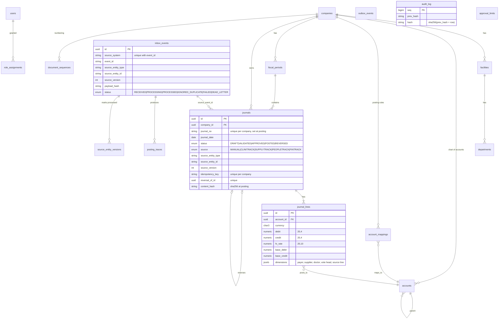

# Entity-relationship model (Increment 1)

Source of truth: `apps/api/prisma/schema.prisma`. Later increments add sub-ledger entities that link to `journals`.

Key uniqueness rules: `journals(company_id, idempotency_key)`, `journals(company_id, journal_no)`, `inbox_events(source_system, event_id)`,
`source_entity_versions(source_system, source_entity_type, source_entity_id, source_version)`, `accounts(company_id, code)`,
`fiscal_periods(company_id, code)`.
